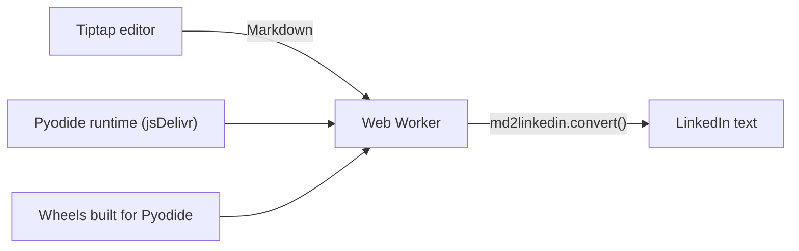

# LinkedIn post formatter

A static web page for formatting LinkedIn posts. Write with bold, italics,
headings, lists, and code in a rich-text editor, and copy a version that spells
that formatting in Unicode characters, which LinkedIn keeps when you paste.

The conversion is the [md2linkedin](https://github.com/IndrajeetPatil/md2linkedin)
Python package itself, running in the browser on
[Pyodide](https://pyodide.org/). There is no server: the text never leaves the
reader's device.

## How it works



- [Tiptap](https://tiptap.dev/) and its Markdown extension turn the formatted
  text into Markdown.

- A Web Worker loads Pyodide from jsDelivr and installs three wheels served
  with the page: `md2linkedin`, and its native dependencies `comrak` (Rust)
  and `selectolax` (C). Pyodide does not ship the last two, so
  `scripts/build-wheels.sh` cross-compiles them to WebAssembly for the Pyodide
  release pinned in `package.json`.

- The worker calls `md2linkedin.convert()` on every edit and returns the
  text.

## Development

Needs Node.js 26 with [Vite+](https://viteplus.dev/) (`vp`),
[uv](https://docs.astral.sh/uv/), and [rustup](https://rustup.rs/).

```sh
vp install        # JavaScript dependencies
vp run wheels     # Cross-compile the Python wheels into src/wheels/ (a few minutes)
vp dev            # Development server
vp check          # Format, lint, and type-check
vp run e2e        # End-to-end tests in Chromium, Firefox, and WebKit
```

The versions of the Python packages live in `wheels/requirements.txt`.

## Deployment

`.github/workflows/pages.yml` builds the wheels and the site on every push to
`main` and deploys it to GitHub Pages.

## Licence

MIT
